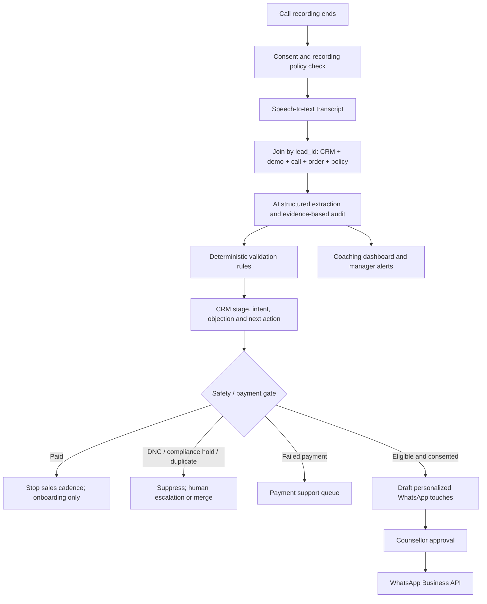

# End-to-End Architecture

## Data contracts
- Primary join key: `lead_id`; validate `student_id` and `class_id` across tables.
- Transcript matching: `transcript_filename` from call log.
- Payment matching: `lead_id` and `student_id` from orders.
- Policy matching: `class_id` and currency/market.
- PII stays masked in prototype exports.

## Human-in-the-loop gates
**Always require human approval:** discounts, refunds, payment disputes, compliance alerts, ambiguous policy claims, schedule/batch promises, child distress or age mismatch, and any low-confidence extraction. A counsellor approves every first-touch campaign during pilot.

**May automate after controls:** CRM field population, duplicate suggestions, call-score draft, payment-state synchronization, and pre-approved transactional notifications. Promotional WhatsApp messages require valid opt-in, approved template/window and frequency caps.

## Deterministic hard stops
1. `Paid` order => `Enrolled_Paid`, suppress sales follow-up.
2. Explicit do-not-contact => global promotional suppression.
3. Discount above policy cap or unauthorized link => compliance hold.
4. Failed payment => payment-support queue; no second charge without confirmation.
5. Duplicate student/user/mobile => merge candidate; do not send duplicate message.
6. Child distress/age mismatch => academic review; no payment CTA until verified resolution.
7. Unverified seat scarcity, guarantee, refund, 1:1 or learning outcome => block claim and flag.

## Reliability controls
- Store source IDs and transcript timestamps with every extracted claim.
- Use JSON schema validation and reject malformed outputs.
- Keep immutable transcript and audit logs; record prompt/model/version.
- Confidence below 0.75 or conflicting sources => human review.
- Reconcile currency, fee, discount and net-payable arithmetic before payment link creation.
